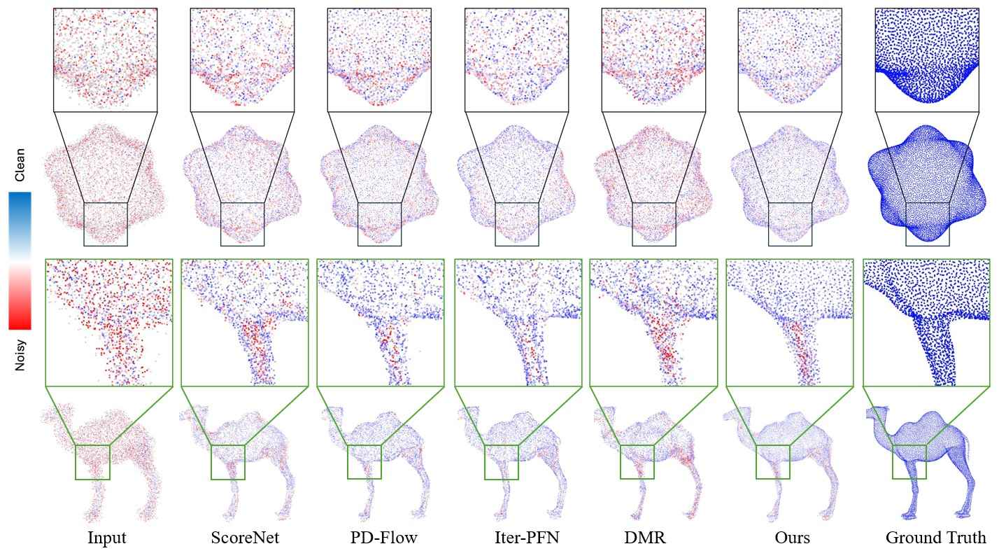

# PointNDF: Cascaded Neural Displacement Fields for Point Cloud Denoising

**Michael Wang¹ and Pingping Cai²**

¹ Dutch Fork High School, Irmo, SC, USA  
² University of South Carolina, Columbia, SC, USA

**Accepted to MMM 2027 (International Conference on Multimedia Modeling)**

**[Paper (PDF)](./PointNDF.pdf)** | **[Code](https://github.com/peridous/PointNDF)**

## Overview

PointNDF is a deep learning framework for point cloud denoising that combines **Point Transformer V3 (PTv3)** with **cascaded Neural Displacement Fields (NDFs)** to progressively recover clean geometry from noisy 3D point clouds.



*Qualitative comparison on 10K-point clouds with 3% Gaussian noise.*

The framework consists of three main components:

- **PTv3-based feature extraction:** Aggregates geometric information into a shared patch-level descriptor.
- **Neural Displacement Fields:** Fuse global geometric context with local point-wise features to predict displacements using bounded-vector and scale-factor branches.
- **Cascaded refinement:** Three NDF stages progressively refine point coordinates while propagating local features across stages.

PointNDF is evaluated on **PU-Net** and **ModelNet10** across 10K- and 50K-point resolutions and Gaussian noise levels of 1%, 2%, and 3%.

## Setup

We used Python 3.10, PyTorch 2.5.1, and CUDA 11.8.

```bash
python -m pip install -r requirements.txt
python -m pip install -e third_party/pointnet2
python -m pip install "git+https://github.com/facebookresearch/pytorch3d.git@b6a77ad7aaf41ed90fca80ce6a2bac3c462a7881"
```

The Chamfer extension in `pointndf/ops` is compiled the first time it is imported.

## Data

Download PU-Net and ModelNet10 separately. The PU-Net folders should look like this:

```text
PUNet/
  pointclouds/
    train/{10000,30000,50000}_poisson/
    test/clean/{10000,50000}_poisson/
    test/noise/{10000,50000}_poisson_{0.01,0.02,0.03}/
  meshes/test/
```

ModelNet10 uses the same test folder layout. Put its meshes in `meshes/test/10000_poisson/`.

## Training

Check that the dataset is in the right place:

```bash
python train.py --data-root /path/to/PUNet --output runs/check --check-data
```

Before a full run, try one batch on the GPU:

```bash
python train.py --data-root /path/to/PUNet --output runs/smoke --epochs 1 --batch-size 2 --workers 0 --max-batches 1 --val-limit 1 --patch-batch-size 2
```

Train the model:

```bash
python train.py --data-root /path/to/PUNet --output runs/pointndf
```

## Inference

```bash
python infer.py --dataset punet --data-root /path/to/PUNet --checkpoint /path/to/pointndf.pth --resolution 10000_poisson --noise 0.01 --output runs/punet_10k_001
```

Use `--all` to run every resolution and noise level.

## Evaluation

```bash
python evaluate.py --dataset punet --data-root /path/to/data --predictions /path/to/predictions --resolution 10000 --noise 0.01 --output runs/metrics
```

Add `--p2m` to compute point-to-mesh distance.

The original checkpoint loads correctly and the model has 39,119,148 parameters. 

Third-party notices are listed in `THIRD_PARTY.md` and `licenses/`.
